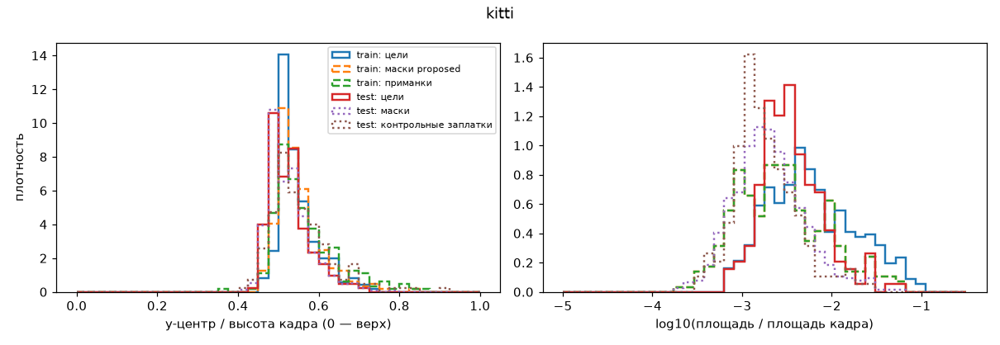
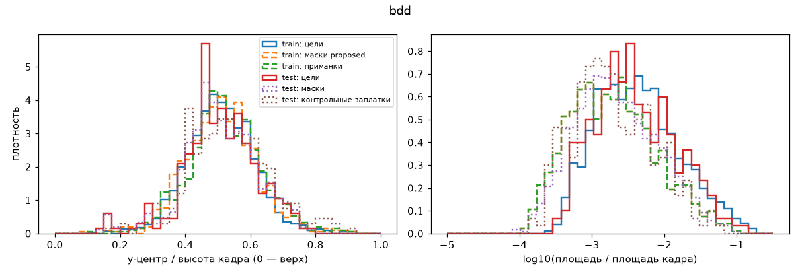

# Положение и размер заплаток: цели / маски / приманки / контроль

Правило размещения приманок и контрольных заплаток: `like_targets` (вертикальный диапазон случайной цели train, заплатка в нём — равномерно, x — равномерно). Приманки обучения — моделирование режима proposed на целях train (без изображений). KS — статистика Колмогорова–Смирнова по y-центру: относительно целей и относительно масок той же части (приманки и контроль должны быть похожи на маски: те же размеры, то же положение по высоте).

| датасет | набор | n | y-центр: медиана | площадь: медиана, % кадра | KS к целям | KS к маскам |
|---|---|---|---|---|---|---|
| kitti | train: цели | 498 | 0.533 | 0.530 | 0.000 | 0.058 |
| kitti | train: маски proposed | 257 | 0.537 | 0.257 | 0.058 | 0.000 |
| kitti | train: приманки | 257 | 0.545 | 0.257 | 0.131 | 0.148 |
| kitti | test: цели | 170 | 0.517 | 0.326 | 0.000 | 0.034 |
| kitti | test: маски | 680 | 0.517 | 0.189 | 0.034 | 0.000 |
| kitti | test: контрольные заплатки | 170 | 0.540 | 0.163 | 0.218 | 0.201 |

| bdd | train: цели | 1619 | 0.506 | 0.394 | 0.000 | 0.023 |
| bdd | train: маски proposed | 832 | 0.509 | 0.185 | 0.023 | 0.000 |
| bdd | train: приманки | 832 | 0.519 | 0.185 | 0.057 | 0.058 |
| bdd | test: цели | 267 | 0.510 | 0.343 | 0.000 | 0.023 |
| bdd | test: маски | 1068 | 0.503 | 0.196 | 0.023 | 0.000 |
| bdd | test: контрольные заплатки | 267 | 0.526 | 0.171 | 0.105 | 0.096 |

## Проверка контрольных заплаток

| датасет | часть | заплаток | за кадром | на размеченном объекте | вне [min y1, max y2] целей train |
|---|---|---|---|---|---|
| kitti | calib | 164 | 0 | 0 | 0 |
| kitti | test | 170 | 0 | 0 | 0 |
| bdd | calib | 289 | 0 | 0 | 0 |
| bdd | test | 267 | 0 | 0 | 0 |
