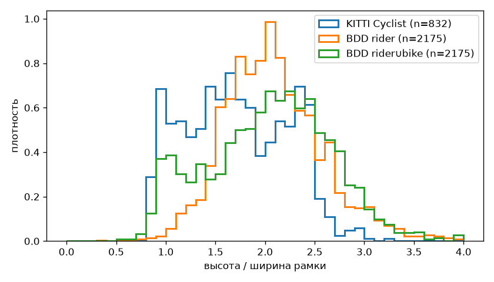

# Форма целевой рамки: KITTI Cyclist против BDD100K

Отобранные объекты (после всех фильтров). Отношение высота/ширина, квартили Q1 / медиана / Q3.

| рамка | объектов | высота/ширина |
|---|---|---|
| KITTI Cyclist | 832 | 1.30 / 1.68 / 2.16 |
| BDD rider | 2175 | 1.75 / 2.05 / 2.39 |
| BDD rider∪bike | 2175 | 1.63 / 2.09 / 2.48 |

Доля площади rider∪bike вне рамки rider (медиана): 28%. KITTI Cyclist размечает человека вместе с велосипедом, BDD rider — только человека.

